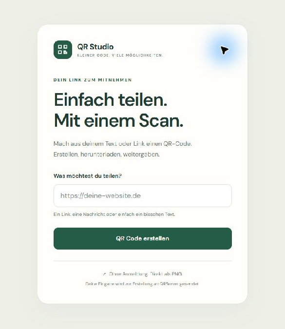

# QR Studio

Ein responsiver QR-Code-Generator zum Erstellen von QR-Codes für Texte und URLs mit HTML, CSS und JavaScript.

## Vorschau

## Funktionen

- QR-Codes für Texte und Links mit Sonderzeichen
- QR-Code als PNG herunterladen
- Bedienung per Button oder Eingabetaste
- Ladeanzeige und Fehlermeldungen
- Responsives Layout und deutsche Benutzeroberfläche

## Lokal starten

`index.html` im Browser öffnen. Keine Installation, kein Build und kein API-Schlüssel erforderlich.

## Verwendung

1. Text oder Link eingeben.
2. **QR Code erstellen** anklicken oder Enter drücken.
3. Den angezeigten QR-Code scannen.
4. Optional mit **PNG herunterladen** speichern.

## Technologien

HTML5, CSS3, Vanilla JavaScript, QRServer API und Google Fonts (DM Sans).

## Externe Dienste und Datenschutz

Für die QR-Code-Erstellung ist eine Internetverbindung erforderlich. Der eingegebene Text oder Link wird an `api.qrserver.com` übertragen. Keine Passwörter oder vertraulichen Daten eingeben. Die Schrift wird von Google Fonts geladen.

## GitHub Pages

Die Projektdateien direkt in das Stammverzeichnis des Repositorys hochladen, sodass `index.html` dort liegt.

Nach dem Hochladen unter **Settings → Pages** die Veröffentlichung aus dem gewünschten Branch und dem Stammverzeichnis (`/`) aktivieren. Kein Build-Schritt erforderlich.

Eine öffentliche Live-Demo ist noch nicht eingerichtet. Nach der Veröffentlichung kann die von GitHub Pages angezeigte URL hier ergänzt werden.

## Dateien

- `index.html`: Seitenstruktur
- `style.css`: Gestaltung
- `script.js`: QR-Code-Erstellung und Statusmeldungen
- `images/preview.png`: Screenshot der Anwendung

## Projektumfang

Ein Frontend-Lernprojekt ohne Backend, Datenbank oder Build-Werkzeuge. Die QR-Codes werden von einem externen Dienst erzeugt.
